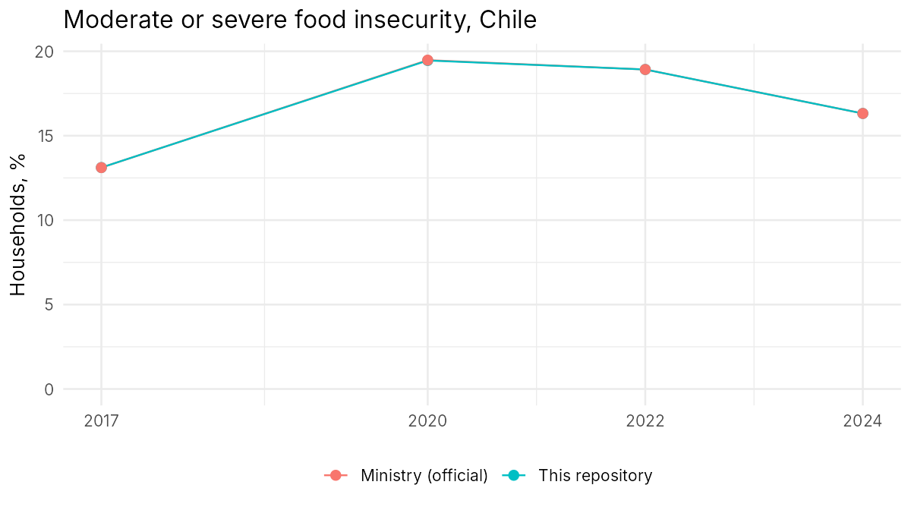
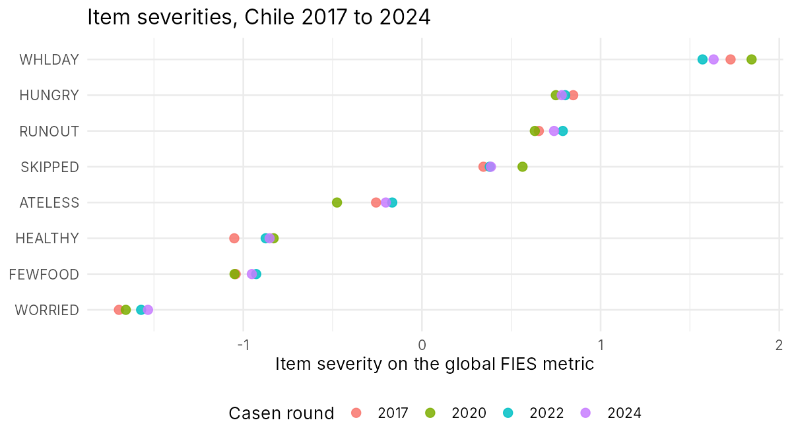
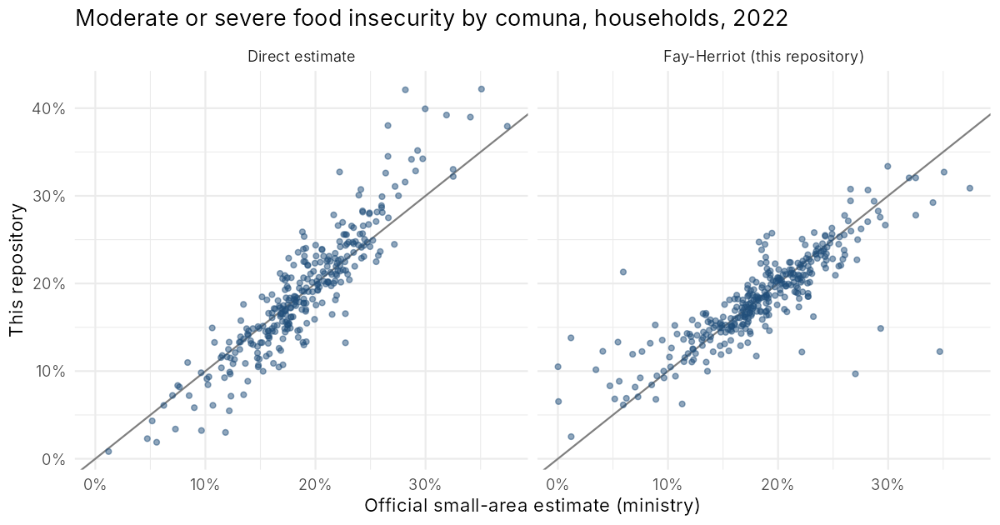
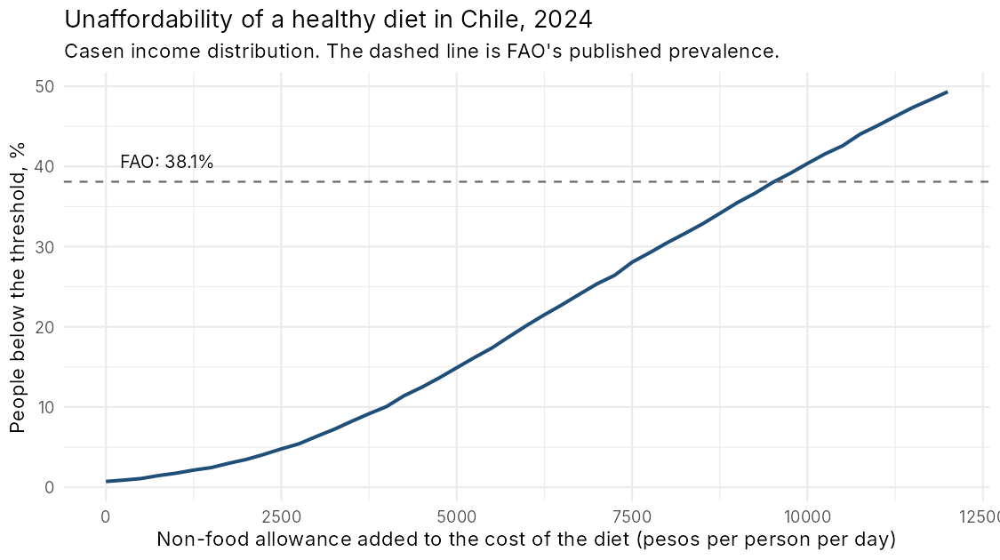

# Food security statistics from public household surveys: Chile, 2017 to 2024

This repository reproduces Chile's official food insecurity figures (SDG indicator 2.1.2) from
public Casen microdata with FAO's method, estimates them by comuna with a small-area model and
measures how far the affordability of a healthy diet depends on a single assumption. Each result
is compared with the figures that the Ministry of Social Development and FAO publish.

> The tasks follow the work of a food security statistics unit, which covers the Food Insecurity
> Experience Scale (FIES) and its Rasch model, comparability over time, small-area estimation and
> the cost and affordability of a healthy diet. The final section names the tasks that remain
> outside the scope of this repository.

## Scripts and results

| Step | Script | Result |
|---|---|---|
| Download public files | `R/00_download.R` | Casen 2017, 2020, 2022, 2024 and the official tables |
| Official figures to compare with | `R/00_benchmarks.R` | `benchmarks/` |
| Household file with the eight scale items | `R/01_prepare_fies.R` | 284,569 households in four rounds |
| Rasch model, equating to the global scale, prevalence | `R/02_rasch_prevalence.R` | National and regional prevalence with standard errors |
| Small-area estimates by comuna | `R/03_sae_comuna.R` | 345 comunas, compared with the ministry's estimates |
| Affordability of a healthy diet | `R/04_healthy_diet.R` | Sensitivity of FAO's indicator to the non-food allowance |

```bash
Rscript install_packages.R
Rscript R/00_download.R      # Casen 2017 comes as .rar and has to be unpacked by hand
Rscript R/00_benchmarks.R
Rscript R/01_prepare_fies.R
Rscript R/02_rasch_prevalence.R
Rscript R/03_sae_comuna.R
Rscript R/04_healthy_diet.R
```

## Results

### 1. Prevalence of food insecurity

The table shows the share of households with moderate or severe food insecurity and with severe
food insecurity in each round, with standard errors that follow the survey design (strata and
primary sampling units).

| Round | Moderate or severe | Official | Severe | Official |
|---|---|---|---|---|
| 2017 | 13.11% (0.27) | 13.11% | 3.31% (0.10) | 3.27% |
| 2020 | 19.45% (0.25) | 19.48% | 3.63% (0.09) | 3.59% |
| 2022 | 18.92% (0.21) | 18.92% | 3.54% (0.08) | 3.54% |
| 2024 | 16.32% (0.17) | 16.32% | 3.52% (0.07) | 3.52% |

For 2022 and 2024 the scripts reproduce the official national figure and all 16 regional figures
to the second decimal. For 2017 and 2020 the national figures fall within 0.05 points of the
official ones, while the regional figures differ by 0.2 and 0.4 points on average.

Reaching those figures required the two estimation choices described below, which the ministry's
report leaves undocumented.

- **The top raw score.** A household that answers yes to all eight items has no finite position on
  the scale, so the model needs an assumed score for it. The default of FAO's package (a pseudo
  raw score of 7.5) places severe food insecurity 0.2 to 0.6 points below the official figure in
  every round, whereas a value of 7.6 reproduces it.
- **Items that depart from the global scale.** With the default tolerance all eight items count
  as common with FAO's global standard, which leaves 2017 and 2020 at 0.6 points above the
  official figure. Treating the "worried" item as specific to Chile in 2017, together with
  "skipped a meal" in 2020, brings both rounds to within 0.03 points.

The choice between the two specifications, both stored in `output/prevalence_national.csv`,
matters for anyone comparing rounds, given that the 2017 to 2022 change is 5.8 points with the
choices that match the official figures and 5.2 points with the package defaults.



### 2. Quality of the scale

| Round | Households | Rasch reliability | Infit range | Items common with the global standard |
|---|---|---|---|---|
| 2017 | 70,248 | 0.78 | 0.74 to 1.21 | 7 of 8 |
| 2020 | 62,911 | 0.77 | 0.73 to 1.32 | 6 of 8 |
| 2022 | 72,056 | 0.79 | 0.75 to 1.26 | 8 of 8 |
| 2024 | 78,654 | 0.77 | 0.78 to 1.27 | 8 of 8 |

Infit, which measures how closely the answers to each item follow the model, stays inside the 0.7
to 1.3 range that FAO treats as acceptable, with the exception of "worried" in 2020 (1.32). The
same item has a high outfit in every round (3.2 to 6.6), which indicates that some households
reporting severe experiences answered no to the question on worrying. The ranking of item
severities remains stable across the four rounds.



Two changes in the questionnaire affect comparability across rounds, since in 2020 and 2022 the
interviewers skipped the last four questions for households that answered no to the first four.
The scripts record those skipped answers as no and exclude the 700 households that gave a
"does not know" answer in 2017.

### 3. Food insecurity by comuna, 2022

A Fay-Herriot model, which combines each comuna's direct estimate with a regression prediction,
covers 308 comunas, while the other 37 receive a synthetic estimate from the regression alone.
The table compares both with the small-area estimates that the ministry publishes.

| Estimate | Comunas | Mean absolute difference from official | Inside the official interval |
|---|---|---|---|
| Direct | 308 | 2.3 points | 95% |
| Fay-Herriot | 308 | 1.4 points | 99% |
| Synthetic, comunas outside the model | 30 | 7.1 points | 73% |

The model's root mean squared error falls below the direct standard error in all but one comuna,
which confirms the gain in precision. The synthetic estimates are weak, so they serve only as a
rough reference for comunas that lack a direct estimate.



The file `docs/img/comuna_map.png` shows the map of the comuna estimates, which is too tall to
display inside this page.

### 4. Affordability of a healthy diet

FAO reports that 42.5% of people in Chile were unable to afford a healthy diet in 2022, at a cost
of 2,186 pesos per person per day. FAO's threshold adds to the cost of the diet a cost of basic
non-food needs, which depends on the country's income group. The table applies several thresholds
to Casen's income distribution.

| | 2017 | 2020 | 2022 | 2024 |
|---|---|---|---|---|
| FAO's published prevalence | 50.1% | 51.7% | 42.5% | 38.1% |
| People whose total income is below the cost of the diet | 0.8% | 2.1% | 0.9% | 0.7% |
| People for whom 52% of income is below the cost | 6.0% | 8.5% | 4.8% | 4.5% |
| Monthly income threshold that reproduces FAO's figure, pesos per person | 245,833 | 272,023 | 333,333 | 367,667 |
| That threshold as a share of median income | 1.00 | 1.03 | 0.88 | 0.82 |

FAO's figure for Chile corresponds to an income threshold close to the median income of the
country. The cost of the diet represents about a fifth of that threshold, so the non-food
allowance determines most of the result.



## Limits

- **The two estimation choices are inferred.** They reproduce the official figures, although the
  ministry's report leaves them undocumented, so the match may have a different cause.
- **Standard errors cover sampling only.** FAO's margins of error add the measurement error of
  the Rasch model, which the standard errors reported here leave out.
- **The comuna model uses the ministry's own comuna poverty estimate as a covariate.** That
  estimate is itself a model output, which enters the model next to population and region. The
  ministry's model relies on administrative records that are unavailable in ready form.
- **Sampling variances rest on one median design effect.** The script applies the same median
  design effect to every comuna, which is a rough simplification.
- **The affordability exercise is a sensitivity analysis.** It takes FAO's threshold as given,
  while Casen's income concept changed with the 2024 poverty methodology.
- **One country.** The equating to FAO's global standard is the step that makes countries
  comparable, although this repository estimates Chile alone.

## Outside the scope

- Prevalence of undernourishment (SDG 2.1.1), which rests on FAO's food balance sheets.
- Dietary diversity for women (MDD-W), which needs a dietary recall module that Casen lacks.
- Agricultural census processing and CAPI questionnaires in Survey Solutions.

## Data sources

| Source | Use |
|---|---|
| [Casen, Ministry of Social Development and Family](https://observatorio.ministeriodesarrollosocial.gob.cl/encuesta-casen) | Microdata 2017, 2020, 2022, 2024 |
| [Food insecurity results, Casen 2017 to 2024](https://observatorio.ministeriodesarrollosocial.gob.cl/encuesta-casen-2024) | Official national and regional figures |
| [Comuna estimates of food insecurity, 2022](https://observatorio.ministeriodesarrollosocial.gob.cl/inseguridad-alimentaria-2022) | Benchmark for the small-area model |
| [FAOSTAT, cost and affordability of a healthy diet](https://www.fao.org/faostat/en/#data/CAHD) | Cost of the diet and FAO's prevalence |
| FAO `RM.weights` R package | Rasch model and equating to the 2014 to 2016 global standard |

The repository holds only code, aggregate results and figures, while the microdata stay outside
it on each user's machine. Git ignores the `data/` folder, since the scripts download every file from its official source.

## Author

Camila Bidó

## License

This repository distributes its code and documentation under the MIT License, whose full text is
in the `LICENSE` file.
